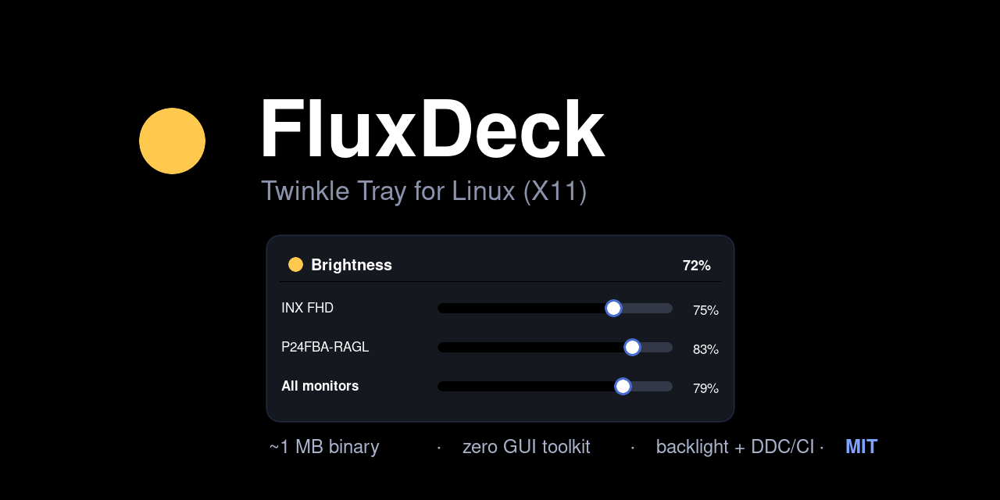

# FluxDeck

Ultra-lightweight Linux brightness tray — Twinkle Tray for X11. Rust, no GUI
toolkit, no Python runtime: one small static-ish binary that talks to X11 and
sysfs/i2c directly. Backlight (laptop panel) + DDC/CI (external monitors).

<!-- badges: CI / crates.io / license — add when publishing -->



[Real UI: multi-monitor sliders with an "All monitors" master row](docs/screenshot.png)

## Why

Twinkle Tray is Windows-only. GNOME/KDE have built-ins; XFCE and other WMs
don't. FluxDeck docks a brightness slider in the tray in ~a few MB of RSS,
with zero GUI toolkit overhead (plain X11 via `x11rb`, the only dependency).

## Build

```sh
cargo build --release
./target/release/fluxdeck
```

## Install

```sh
./install.sh
```

The script builds, adds you to the `i2c` group, installs a udev rule for DDC
access, and copies desktop/autostart entries. Log out and back in afterwards
so the `i2c` group applies.

Manual equivalent:

```sh
cargo build --release
sudo groupadd i2c 2>/dev/null; sudo usermod -aG i2c "$USER"
printf 'SUBSYSTEM=="i2c-dev", KERNEL=="i2c-[0-9]*", MODE="0660", GROUP="i2c"\n' \
  | sudo tee /etc/udev/rules.d/99-fluxdeck-ddc.rules
install -Dm755 target/release/fluxdeck ~/.local/bin/fluxdeck
sed "s|^Exec=.*|Exec=\"$HOME/.local/bin/fluxdeck\"|" fluxdeck.desktop \
  > ~/.local/share/applications/fluxdeck.desktop
sed "s|^Exec=.*|Exec=\"$HOME/.local/bin/fluxdeck\"|" fluxdeck.desktop \
  > ~/.config/autostart/fluxdeck-autostart.desktop
```

## DDC/CI permissions (external monitors)

Kernel i2c devices are `root:i2c 0660`. Without group membership the app still
lists the monitor as `HDMI-A-1 (no permission — run install.sh)` and retries
the open on every set; once you relogin with the `i2c` group (or the udev rule
lands) it starts working without a restart of the app.

## Design

```
┌────────────┐  mpsc commands   ┌──────────────────────────────┐
│ X11 tray UI│ ───────────────▶ │ worker thread                │
│ (x11rb,    │ ◀─────────────── │  - DDC/CI i2c ioctls (paced) │
│  no grabs) │  shared state    │  - sysfs backlight read/write│
└────────────┘  (Mutex)         │  - config save               │
                                │  - discovery rescan / 30s    │
                                └──────────────────────────────┘
```

All blocking I/O lives in the worker thread; the UI thread only copies state
under a mutex held for microseconds. DDC transactions are serialized globally
and paced (one bus lane, 50 ms spacing) because monitor firmware is fragile.

## Troubleshooting

- **Tray icon not shown:** FluxDeck speaks StatusNotifierItem (SNI) natively —
  a zero-dependency raw D-Bus client. XFCE 4.20, KDE Plasma and any SNI host
  render it. If your panel strips `-symbolic` icon suffixes
  (xfconf `symbolic-icons=false`), the icon resolves via `display-brightness`
  in hicolor; otherwise the `display-brightness-{high,medium,low}-symbolic`
  variants are used. Legacy XEmbed panels fall back to the XEmbed icon.
- **External monitor missing / `no permission`:** run `install.sh`, then log
  out and back in. Verify with `groups | grep i2c` and
  `cargo run --example hwprobe`.
- **`hwprobe`:** debug tool that lists discovered displays and round-trips a
  brightness set per backend: `cargo run --release --example hwprobe`.

## License

MIT — see [LICENSE](LICENSE).
